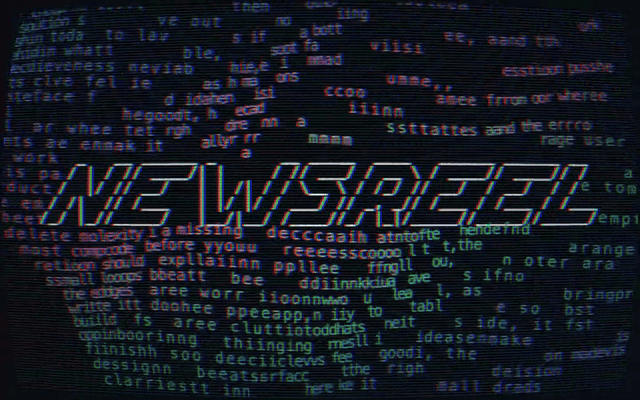

# newsreel

[](https://www.npmjs.com/package/newsreel)
[](https://github.com/e3o8o/newsreel/actions/workflows/ci.yml)
[](LICENSE)

Build a narrated video from a config file.

Playwright drives your real app and records one clip per scene. Narration is spoken by a
local model. ffmpeg frames every clip, cuts it to the length of its own narration, and
assembles the lot with a title card, lower thirds and a music bed. You get an mp4 and a
poster image, and one line in the config decides whether the same shot list comes out as a
shipping report, a product demo, an ad, or a launch film.



*Every frame above was generated by newsreel — the ad for the tool is made by the tool.
Watch the full cut on [newsreel.pages.dev](https://newsreel.pages.dev).*

## Try it in two commands

No app, no login, no API keys. 35 generated scenes ship inside the package, and a video made
only of those runs on a machine that has just installed it:

```bash
npx newsreel init --generated
npx newsreel run
```

To film your own app instead:

```bash
npx newsreel init       # scaffold a commented config; fill in baseUrl, auth, shots
npx newsreel login      # log in once by hand; the session is saved and reused
npx newsreel run        # capture -> cards -> assemble
```

**Working with an agent?** `npx newsreel prompt --copy` puts a self-contained brief on your
clipboard ([AGENT.md](AGENT.md)). Paste it into any coding agent and describe the video you
want.

## What a shot is

Every entry in `shots[]` is either a **captured route** — Playwright opens your app, clicks,
types and scrolls through the actions you listed — or a **generated scene** drawn by one of
the bundled visuals ([the lookbook](visuals/LOOKBOOK.md) lists all 35; they all run live on
[the landing page](https://newsreel.pages.dev)). Both record the same way and cut together
in one timeline.

```json
{ "id": "invoices", "route": "/invoices", "duration": 8,
  "caption": "Invoices", "narration": "Reconciliation now matches on amount and date together.",
  "actions": [ { "type": "waitFor", "selector": "table tbody tr" },
               { "type": "click", "selector": "text=New invoice" } ] }
```

## What a video is for

`video.kind` sets the palette family, accent, music bed, pacing and title-card layout in one
word. The background is rolled from the kind's family, so two ads come out siblings instead
of copies.

| kind | for | feels like |
| --- | --- | --- |
| `report` | a weekly shipping report | calm, legible, unhurried |
| `demo` | a product walkthrough | confident, focused on the screen |
| `ad` | a short loud piece | heat and pace, ends on a call to action |
| `launch` | a launch film | premium, deliberate, a little cinematic |

## Commands

| Command | What it does |
| --- | --- |
| `init` | Scaffold a config. `--generated` for a video that needs no app. |
| `prompt` | Print the agent brief. `--copy` puts it on the clipboard. |
| `presets` | List the background presets. |
| `voices` | List the bundled narration voices. `--install` puts them in Voicebox. |
| `login` | Headed browser, manual login, saves the session. |
| `capture` | Record one clip per shot. `--only <shotId>` re-records one. |
| `cards` | Render the title/closing cards and lower thirds. |
| `assemble` | The ffmpeg cut: frames, narration, music, poster. |
| `compose` | The Remotion cut: animated cards, eased motion. |
| `run` | `capture` -> `cards` -> `assemble`. |

Every command takes `--config <path>`. Paths inside the config resolve against the config
file's directory, never the shell's cwd.

## Requirements

Node 18+, `ffmpeg` on PATH (`brew install ffmpeg`), and Playwright in the project being
filmed: `npm i -D playwright && npx playwright install chromium`. Playwright is an optional
peer dependency — your project almost certainly has it, and a second copy would only be a
version fight. Narration and music are local and bundled; nothing needs an account.

## Documentation

| | |
| --- | --- |
| [Configuration](docs/configuration.md) | the full config contract, backgrounds, styling |
| [Rendering](docs/rendering.md) | the pipeline, assemble vs compose, verifying a cut |
| [Voice and music](docs/providers.md) | the bundled voices and beds, hosted options |
| [Gotchas and limits](docs/gotchas.md) | every entry cost real time once |
| [Development](docs/development.md) | adding a provider, the skill folder, releasing |
| [Scene lookbook](visuals/LOOKBOOK.md) | all 35 generated scenes, their props, when to use each |
| [Agent brief](AGENT.md) | hand this to a coding agent and it can drive newsreel |

## Licence

MIT. See [LICENSE](LICENSE).

`assets/bettershot-presets.json` contains colour values and a shadow formula derived from
[BetterShot](https://github.com/KartikLabhshetwar/better-shot) (BSD-3-Clause). The values were
read from its source and re-expressed as data; no BetterShot code is included. Its licence and
copyright notice are reproduced in [LICENSE](LICENSE).
